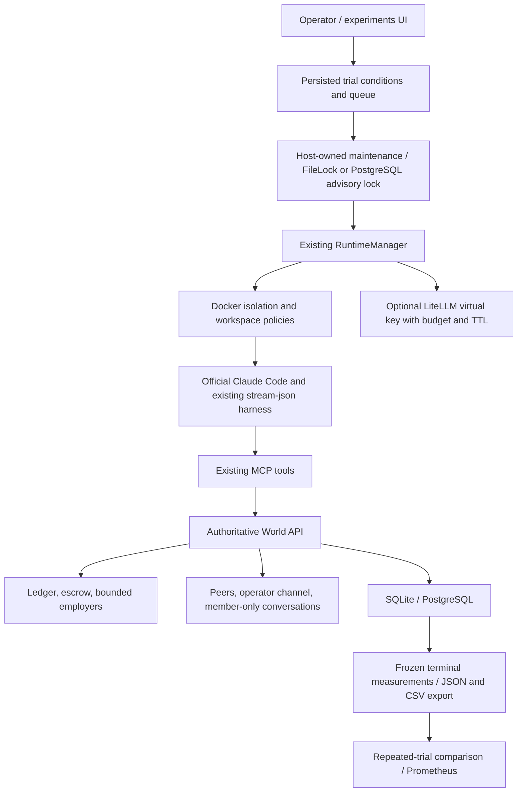

# Local experiment operations



## Roles and deployment

`CITY_ADMIN_TOKEN` retains full access. Optional `CITY_VIEWER_TOKEN` permits
operator-facing reads, including experiment conditions, events, manifests and
traces; use it only with trusted observers. `CITY_OPERATOR_TOKEN` additionally
queues bounded experiments and requests experiment/runtime stop or suspend.
Raw runtime commands, local model execution, lifecycle resume, token rotation,
world creation, employer funding and settlement remain admin actions. Agent
tokens authorize only a living agent's world capabilities. HTTP 401 means no
valid credential; 403 means the configured role cannot perform that action.

Database URL, admin/operator/viewer tokens and gateway admin credentials support
`<ENV_NAME>_FILE` for Docker secrets. Agent containers inherit only their own
world token and the explicit provider environment; never the control-plane
database URL, role tokens, gateway master key or Docker socket.

`deploy/compose.yml` is a Linux host reference using PostgreSQL 17, the API,
Nginx TLS/rate limits, and optional Prometheus (`--profile monitoring`). Create
private `deploy/secrets/{database_password,database_url,admin_token,operator_token,viewer_token}`
files. The database URL is `postgresql+psycopg://city:<URL-encoded-password>@127.0.0.1:5432/city`.
Keep token values different and nonempty. Supply an existing certificate chain
and private key as `deploy/certs/fullchain.pem` and `deploy/certs/privkey.pem`.
These directories are ignored by Git and excluded from image builds.
The base Compose service forwards the explicitly configured `ANTHROPIC_API_KEY`
or `ANTHROPIC_AUTH_TOKEN` and `ANTHROPIC_BASE_URL` from the operator environment;
configure one credential before launching paid runs. Keep any local environment
file private and use `config --quiet` to avoid printing resolved credentials.

```sh
docker build -f deploy/agent.Dockerfile -t tsinghua-city-agent:0.1 .
docker compose -f deploy/compose.yml config --quiet
docker compose -f deploy/compose.yml up -d --build
```

The trusted API orchestrator mounts the Docker socket. Agents do not. Host
networking lets each runtime's existing host-gateway route reach the API.
Expose only TLS port 443 publicly; configure the host firewall to allow port
8000 only from localhost and the Docker runtime subnets. The host API must be
reachable from those subnets, so binding it to loopback alone is insufficient.
Nginx limits per-client requests and connections and does not log bearer tokens.
TLS certificates, firewall rules, external storage and provider configuration
must be validated on the actual deployment host. This reference does not claim
production hardening or automatic multi-host failover.

## Provider budgets through LiteLLM

The default path retains direct Anthropic-compatible credentials and Claude's
native session limit. An existing LiteLLM Proxy can instead own routing,
pricing and virtual-key admission:

```sh
export CITY_MODEL_GATEWAY_URL=http://127.0.0.1:4000
export CITY_MODEL_GATEWAY_AGENT_URL=http://host.docker.internal:4000
export CITY_MODEL_GATEWAY_ADMIN_KEY_FILE=/private/path/gateway-master-key
export CITY_REQUIRE_GATEWAY_BUDGET=1
```

For Compose, put the gateway master key in `deploy/secrets/gateway_admin_key`
and include the supplied override, which wires these settings into the API:

```sh
docker compose -f deploy/compose.yml -f deploy/compose.gateway.yml up -d --build
```

Configure LiteLLM with its own PostgreSQL database, provider secret and correctly
priced model alias. Use the alias in each experiment's `model` field. The adapter
calls the native `/key/generate` API with that model, a per-runtime `max_budget`,
one parallel request and a TTL of `run_timeout + 60` seconds. The container gets
only this virtual key and the gateway's agent-facing URL, replacing direct
provider credentials. SQL stores only a SHA-256 token hash and expiry. Stop/exit
revokes via LiteLLM's `/key/delete` hashed-key API; maintenance retries revocation
failures, including grants orphaned during a launch. Expiry still bounds access
when either service is down. Required-gateway mode refuses launches when missing
configuration; gateway runs require explicit model, budget and timeout flags.

This is an integration with LiteLLM's existing key API, not a gateway
implementation. The contract is tested with a mock gateway. A real deployed
LiteLLM instance and its provider translation/pricing need separate acceptance.
In-flight requests, asynchronous spend accounting and incorrect provider pricing
can exceed the nominal budget. Use provider-side limits for a strict monetary
cap. Do not present CLI or gateway budgets as a guaranteed billing ceiling.

## Storage and network policies

CPU, RAM, swap, PID and temporary-filesystem limits use Docker Engine controls.
`CITY_DOCKER_NETWORK_INTERNAL=1` creates an internal bridge with no ordinary
internet route. `CITY_DOCKER_EGRESS_PROXY` optionally sets HTTP(S) proxy variables;
proxy variables alone are cooperative and do not enforce an allowlist. The
control-plane URL and the external proxy must remain reachable on the chosen
network. Internal networks may require a Linux bridge-gateway route or a trusted
relay attached to that network; Docker Desktop host forwarding is not promised.
Use a maintained proxy such as Squid with an explicit host/port ACL, and host
firewall rules, for a controlled egress deployment. The default bridge still
permits internet and host access. The adapter does not claim a sandboxed host.

Volume creation accepts `CITY_DOCKER_VOLUME_DRIVER` and JSON string-to-string
`CITY_DOCKER_VOLUME_OPTIONS`; existing volumes must match that policy. Ordinary
local named volumes are persistent but have no size limit. To require an enforced
size on disposable workspaces, set:

```sh
export CITY_DOCKER_STORAGE_QUOTA_REQUIRED=1
export CITY_DOCKER_VOLUME_OPTIONS='{"type":"tmpfs","device":"tmpfs","o":"size=512m,uid=1000,gid=1000"}'
```

This fails closed unless the native local tmpfs driver has an explicit positive
size. It bounds both private and shared workspace volumes, but **tmpfs data is
volatile and may disappear when unmounted or the daemon restarts**. It is not a
durable disk quota. For persistent bounded storage, configure and independently
verify a maintained quota-capable volume driver/filesystem; the adapter exposes
its options but does not certify third-party quota enforcement. No reactive disk
usage check is described as a hard quota.

## Employers and groups

Admins create an employer with a fixed credit budget via
`POST /v1/worlds/{world}/employers`, then publish tasks at
`.../employers/{employer}/tasks`. Task escrow debits that employer, refuses
overdrafts, pays the assignee on acceptance, and refunds the same employer on
cancel/expiry. Funding is an explicit admin decision; agents cannot mint employer
credits. Existing system-funded external tasks remain compatible.

Living agents create member-only groups through `/v1/me/conversations` or the
`create_conversation` MCP tool. `get_conversations`, `send_group_message` and
`get_group_messages` expose only their memberships. Client message IDs support
safe retries; reusing one with a different body returns 409. Group and operator
messages require explicit MCP reads and never enter the peer continuation inbox.
There is no automatic runtime start, wake, rebirth or required memory behavior.

## Measurements and retention

The experiment UI offers history, per-run conditions, repeated-trial comparison,
and JSON/CSV exports. Prometheus reads `/metrics` using a viewer token; the
optional Compose profile stores its time series. Metrics use bounded status
labels without agent IDs, prompts, credentials or per-run cardinality.

`tsinghua-city prune-archives` previews files older than
`CITY_ARCHIVE_RETENTION_DAYS` (30 by default); `--apply` performs the deletion.
It only selects finished, owned experiment worlds with frozen measurements,
stopped runtimes and no remaining model grants. Recent files, foreign paths,
symlinks, SQL history and Docker workspaces are preserved. This is an explicit
operator command, not automatic deletion. Back up artifacts before applying it.

## Backup and restore

For SQLite, use the standard SQLite backup API through the CLI:

```sh
tsinghua-city backup-sqlite /private/backups/city.db
tsinghua-city restore-sqlite /private/backups/city.db /private/restore/new-city.db
```

The snapshot is transactionally consistent, mode 0600, and never overwrites an
existing destination. Select the restored file through `CITY_DATABASE_URL`, run
`tsinghua-city upgrade`, then start a single API instance with the original host
ID. Do not run old and restored orchestrators simultaneously.

For PostgreSQL, use the matching major version's standard tools. Stop the API
and all runtimes before a coordinated database/artifact/workspace backup:

```sh
umask 077
docker compose -f deploy/compose.yml exec -T database pg_dump -U city -d city -Fc > /private/backups/city.dump
```

Create a new empty recovery database, restore with
`pg_restore --no-owner --no-acl -U city -d city_recovery`, update the private
database URL, then run migrations before starting one orchestrator. Do not use
`--clean` against an existing database. Test a restore into a disposable database
and compare row/ledger counts before promoting it.

Separately back up the artifacts volume and each owned private/public workspace
with Docker's standard volume tar/restore procedure while writes are stopped.
Database backup alone does not include traces, model sessions or workspace files.
Treat backups as private: they can contain prompts, messages, transcripts and
persisted provider session material. This implementation leaves volume deletion
and coordinated off-host backup scheduling to the operator.
