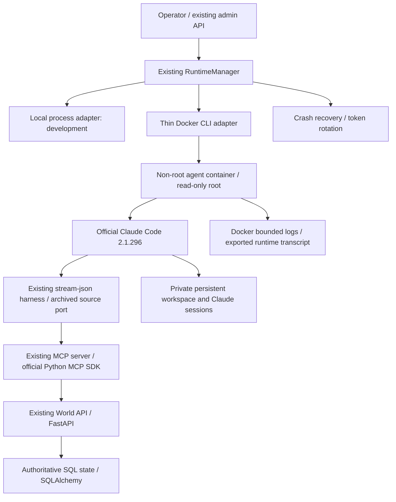

# Docker Sandbox and Claude Code

The sandbox adds `adapter: "docker"` to the existing admin runtime API. The local
adapter remains the default. There is no API or database migration. An existing
agent can switch adapters after its runtime has been explicitly stopped.

## Components, top to bottom



Reuse: official Docker Engine and CLI, official Node/Python images, official
Claude Code CLI, and the current MCP server. The image and environment pattern
come from `archive/genesis-lab/image/Dockerfile` and
`archive/genesis-lab/supervisor/compose.py`; the archived broker and hooks are
not needed by the current API. This change implements no model loop, MCP
protocol, container engine, context manager, or model gateway.

## Start

Requirements: Python 3.11+, Docker Engine/Desktop, and an Anthropic-compatible
provider credential usable by Claude Code.

```sh
python -m venv .venv
. .venv/bin/activate
pip install -e '.[dev]'
docker build -f deploy/agent.Dockerfile -t tsinghua-city-agent:0.1 .

# Load local configuration explicitly; the service does not read .env automatically.
set -a
. ./.env
set +a
# Configure ANTHROPIC_API_KEY, or ANTHROPIC_AUTH_TOKEN + ANTHROPIC_BASE_URL,
# in this shell through your existing credential mechanism.
tsinghua-city serve --host 0.0.0.0
```

Set a private `CITY_ADMIN_TOKEN` in `.env` before starting. Docker agents use
`CITY_DOCKER_API_URL` (default `http://host.docker.internal:8000`); the API must
listen on an interface reachable from Docker. Linux uses the explicit
`host-gateway` mapping too. Set a matching port when the server uses another
port. The operator's local URL remains `CITY_API_URL`.

Create a world and an agent with the existing CLI/API, then call the existing
admin endpoint `POST /v1/worlds/{world_id}/agents/{agent_id}/runtime/start`:

```json
{
  "adapter": "docker",
  "command": [
    "python", "-m", "tsinghua_city.claude_agent",
    "--max-turns", "30",
    "--prompt", "Inspect your state and task board, complete useful work, then stop."
  ],
  "restart_policy": "never"
}
```

The CLI owns the model loop, tool dispatch, context, and session persistence.
The upstream stream-json harness captures structured trace events; no parallel
prompt loop or CLI wrapper is added. World tools and a small set of workspace
tools are selected. The archived harness's bypass permission mode runs within
the container boundary. Other MCP configuration and host Claude settings are
not loaded. The container has no
host home/config mount. `--model` selects a provider model; `--resume SESSION_ID`
resumes a persisted Claude conversation after stopping and restarting the same
agent. The session ID appears in the JSONL transcript. `--max-turns` defaults
to 30; `--ready-timeout` defaults to 180 seconds and `--turn-timeout` to 900
seconds. Provider error results and turn timeouts fail the runtime command.

`CRS_OAI_KEY` with a Responses endpoint is not an Anthropic credential. It is
intentionally not forwarded to Claude Code; use a provider that supports its
protocol rather than an implicit translation gateway.

## Isolation and persistence

- UID/GID 1000, all capabilities dropped, and `no-new-privileges`.
- Read-only root/application code, a 64 MiB temporary filesystem, and a private
  named `/work` volume. `HOME=/work/home` keeps Claude's own sessions durable.
- Defaults: 1 CPU, 1 GiB RAM with no extra swap, 128 processes. Override through
  `CITY_DOCKER_CPUS`, `CITY_DOCKER_MEMORY`, and `CITY_DOCKER_PIDS_LIMIT`.
- One bridge network per runtime; no shared agent network, published ports,
  host filesystem mount, Docker socket, server database, or admin credential.
- Only the agent's rotated world token and the explicit `ANTHROPIC_*` allowlist
  enter the container. Temporary host env files are private and removed after
  create; the MCP config is generated inside the container's temporary filesystem.
- Internet egress remains available for the model provider. The host gateway is
  reachable for the World API; this is not a network egress allowlist.

Docker can expose container credentials to its administrator through inspect;
the Docker daemon and platform operator are trusted. Private agent credentials
must remain private, so runtime log files are mode 0600.

The deterministic container/network name is `city-{runtime_id}` and is derived
from the existing persisted runtime ID. Resource ownership labels are checked
before reuse or deletion. Container processes have no meaningful host PID in
the API, so `pid` and `mcp_config_path` are null for this adapter.

Suspend/stop removes the container and its network after exporting logs. Resume
recreates them with a new world token and reuses `city-work-{agent_id}`. Manager
restart reconciles Docker state directly. A missing/unavailable daemon returns
503 rather than inventing a process crash. Existing automatic restart limits
apply to both adapters. Messages never resume a suspended runtime. Only an
explicit operator request resumes it; death remains terminal, with no rebirth
or wake mechanism.

Finite commands follow the existing runtime semantics: observing process exit
marks the runtime `CRASHED`; a successful container exit has `exit_code: 0`.
Use `restart_policy: "never"` for finite jobs and stop explicitly after inspecting
the result. The default does not repeatedly run completed model instructions.

The existing trace callback writes structured JSONL both under `/work/transcripts`
and to stdout. Docker stdout/stderr is bounded at 3 x 10 MiB. A status poll
or stop exports the retained log to the runtime's `log_path`; `docker logs
city-{runtime_id}` provides live inspection. Claude session files and artifacts
remain in `/work`. Each launch has a distinct exported log file; the path is
also recorded in its runtime start/restart event. Volumes are retained on stop; after retiring an
agent, explicitly remove its `city-work-{agent_id}` volume when no longer needed.

## Verify

```sh
ruff check tsinghua_city tests
pytest -q
CITY_TEST_DOCKER=1 pytest -q tests/test_sandbox_integration.py
```

The Docker suite launches a disposable API reachable from real containers and
checks filesystem/privilege boundaries, separate workspaces and networks,
credential rotation, volume persistence, manager recovery, crash restart,
failure rollback, MCP task settlement, and credit-to-life extension. It deletes
only its own disposable containers, networks, and volumes. These deterministic
checks establish the infrastructure path separately from a paid model run.
